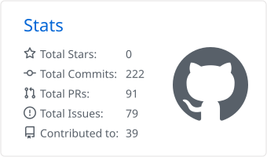

<table width="100%">
<tr>
<td align="left">
<strong>Backend & distributed systems.</strong> Finding bugs in infrastructure other people depend on.
</td>
<td align="right">
<a href="https://www.linkedin.com/in/tanishq-jain-660b5336a/">LinkedIn</a> ·
<a href="https://x.com/imtanishqjain">X</a> ·
<a href="mailto:tanishqjain7014@gmail.com">Email</a>
</td>
</tr>
</table>

I work on **Kubernetes schedulers, AI inference gateways and cloud-native tooling**, mostly on the parts that fail quietly.

▸ **Member** · **[Volcano](https://github.com/volcano-sh)** · CNCF batch scheduling for Kubernetes · credited in the [v1.16.0](https://volcano.sh/blog/volcano-1.16.0-release/) 
▸ **Contributor** · **[Kthena](https://github.com/volcano-sh/kthena)** · CNCF · LLM inference gateway: router auth, autoscaling, workqueue retries, access logging 
▸ **Contributor** · **[Music Blocks](https://github.com/sugarlabs/musicblocks)** · Sugar Labs · ABC, LilyPond and MusicXML export, block runtime 
▸ **Contributor** · **[CircuitVerse](https://github.com/CircuitVerse/cv-frontend-vue)** · digital logic simulator used in classrooms worldwide 
▸ **[50+ merged pull requests](https://github.com/search?q=author%3Aiamtanishqjain+is%3Apr+is%3Amerged&type=pullrequests)** across CNCF projects and other organizations 
▸ **[70+ issues filed](https://github.com/search?q=author%3Aiamtanishqjain+is%3Aissue&type=issues)** · most of what I fix, I found first 
▸ **CERN Human-AI Team** · speech transcription and scoring for second-language acquisition research 
▸ **Amazon ML Summer School 2026** · shortlisted from 130,000+ applicants 

Currently deep in **Volcano** and **Kthena**.

### Selected Fixes

| | |
|---|---|
| [kthena#1831](https://github.com/volcano-sh/kthena/pull/1831) | An unset `auth.issuer` silently rejected every token the router was given. |
| [kthena#1788](https://github.com/volcano-sh/kthena/pull/1788) | Retry count never reset on success, so one flaky sync permanently shrank the budget. |
| [volcano#6042](https://github.com/volcano-sh/volcano/pull/6042) | A jobflow whose jobs finished before the first sync never settled. |
| [kthena#1900](https://github.com/volcano-sh/kthena/pull/1900) | A negative `maxWaitingRequests` quietly disabled least-request balancing. |

The recurring shape: **state promoted only on an edge, with nothing to reconcile it afterwards.** Miss the event once and it stays wrong forever, with no error in the log.

### Projects

▸ **[AutoEIT](https://github.com/iamtanishqjain/AutoEIT)** · speech transcription and scoring for Spanish Elicited Imitation Tests · `Whisper` `NLP` 
▸ **[Mini Onyx](https://github.com/iamtanishqjain/mini-onyx)** · fully offline RAG platform, custom vector store, local Llama 3 · `FastAPI` `Next.js` `Ollama` 
▸ **[Legal Compliance AI](https://github.com/iamtanishqjain/legal-compliance-ai)** · labour-law risk screening for employment contracts · `MiniLM` `FastAPI` `Docker` 

 

<picture>
  <source media="(prefers-color-scheme: dark)" srcset="https://raw.githubusercontent.com/iamtanishqjain/iamtanishqjain/main/profile-summary-card-output/github_dark/3-stats.svg" />
  
</picture>

